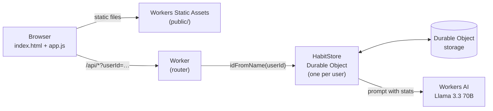
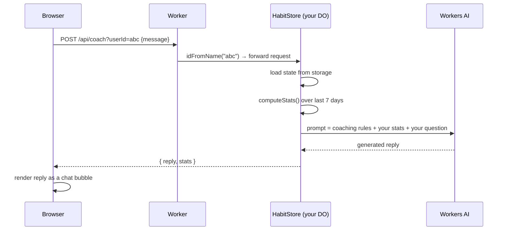

# Habit Coach 🧭

**An AI-powered habit tracker and coach that runs entirely on Cloudflare's edge — Workers for the API, Durable Objects for per-user storage, and Workers AI (Llama 3.3 70B) for personalised coaching.**


Built as my submission for the **Cloudflare Summer Internship 2026** AI application assignment, which asked for an AI app using an LLM, workflow/coordination, user input, and memory/state — all on Cloudflare.

---

## Table of contents

- [What it does](#what-it-does)
- [How it maps to the assignment](#how-it-maps-to-the-assignment)
- [Architecture](#architecture)
- [How a request flows through the system](#how-a-request-flows-through-the-system)
- [Data model](#data-model)
- [How progress is calculated](#how-progress-is-calculated)
- [How the AI coach works](#how-the-ai-coach-works)
- [API reference](#api-reference)
- [Running it locally](#running-it-locally)
- [Deploying to Cloudflare](#deploying-to-cloudflare)
- [Project structure](#project-structure)
- [Design decisions and trade-offs](#design-decisions-and-trade-offs)
- [What I'd build next](#what-id-build-next)

---

## What it does

| Feature | Description |
|---|---|
| **Create habits** | Give a habit a name (e.g. *"Read 20 minutes"*), a frequency, and a target — like *1 per day* or *3 per week*. |
| **Log completions** | One click on **Log done** records a timestamped completion. |
| **7-day progress** | Each habit shows how many times you did it in the last 7 days against your weekly target, as a colour-coded badge (green ≥ 80 %, red < 40 %). |
| **AI coach chat** | Ask anything — *"How am I doing this week?"*, *"Which habit should I focus on?"* — and the coach replies using **your real numbers**, not generic advice. |
| **Private, persistent memory** | Every browser gets its own anonymous ID, and that user's habits live in their own Durable Object, so data survives refreshes and restarts with no sign-up. |

---

## How it maps to the assignment

| Requirement | How Habit Coach meets it |
|---|---|
| **LLM** | Workers AI running `@cf/meta/llama-3.3-70b-instruct-fp8-fast` |
| **Workflow / coordination** | A Worker routes every `/api/*` request to the right user's Durable Object, which validates, updates state, recomputes stats and (for chat) builds the prompt and calls the model |
| **User input** | A chat interface plus forms for creating and logging habits |
| **Memory / state** | One Durable Object per user, storing habits and completion logs in Durable Object storage |

---

## Architecture



There are three moving parts, all deployed together by a single `wrangler deploy`:

1. **Static frontend (`public/`)** — plain HTML, CSS and JavaScript with no framework or build step, served by Workers Static Assets.
2. **Worker (`src/worker.ts`, default export)** — a thin router. Anything that isn't `/api/*` is handled by the asset server; every `/api/*` request is forwarded to the caller's Durable Object.
3. **`HabitStore` Durable Object** — the brain of the app. It owns one user's data, runs all the business logic, and is the only component that talks to the AI model.

---

## How a request flows through the system

Here's what happens when you ask the coach *"How am I doing?"*:



1. **Identity.** On first visit, `app.js` generates a random UUID and saves it in `localStorage`. Every API call carries it as `?userId=…`.
2. **Routing.** The Worker calls `env.HABIT_STORE.idFromName(userId)`. The same name always maps to the same Durable Object instance, anywhere in the world, so each user always reaches *their own* data.
3. **Consistency.** A Durable Object processes requests for one ID one at a time, so two rapid clicks on **Log done** can never overwrite each other — no locks or database transactions needed.
4. **Response.** Every write endpoint returns the full updated state *and* fresh stats, so the frontend re-renders from one response instead of making a second request.

---

## Data model

All of a user's data is a single JSON object stored under the key `"state"` in their Durable Object:

```ts
interface UserState {
  habits: Habit[];
  logs: HabitLog[];
}

interface Habit {
  id: string;                    // crypto.randomUUID()
  name: string;                  // "Read 20 minutes"
  frequency: "daily" | "weekly";
  targetPerPeriod: number;       // e.g. 1 per day, or 3 per week
  period: "day" | "week";
  createdAt: string;             // ISO timestamp
}

interface HabitLog {
  id: string;
  habitId: string;               // which habit was completed
  timestamp: string;             // when it was completed
}
```

Logs are an append-only event list rather than a counter. That keeps the full history, so any statistic (streaks, best day of the week, monthly trends) can be computed later without changing what's stored.

---

## How progress is calculated

`computeStats()` runs on every request and, for each habit:

1. Counts logs for that habit with a timestamp in the **last 7 days** (a rolling window, not a calendar week).
2. Converts the target to a **weekly target**: a *per-day* target is multiplied by 7, and a *per-week* target is used as-is.
3. Works out the **completion rate** = completions ÷ weekly target, capped at 100 %.

| Habit | Target | Weekly target | Logged in last 7 days | Rate |
|---|---|---|---|---|
| Read 20 minutes | 1 per day | 7 | 5 | 71 % |
| Gym | 3 per week | 3 | 3 | 100 % |
| Meditate | 2 per day | 14 | 4 | 29 % 🔴 |

---

## How the AI coach works

The model never sees raw logs. Instead the Durable Object turns the stats into a compact, readable summary and wraps it in a prompt with clear rules:

```text
You are an encouraging, practical AI habit coach.
You see the user's habit definitions and their performance over the last 7 days.
Give clear, concise feedback and *one or two* actionable suggestions.

Be:
- Short (2–4 paragraphs max)
- Concrete (numbers, patterns, examples)
- Supportive (no shaming).

User's habit data:

Habit: Read 20 minutes
- Completed last 7 days: 5
- Target per week: 7
- Completion rate: 71%

User's question or message:
"How am I doing this week?"
```

Why it's built this way:

- **Grounded answers.** Because the coach's context is the user's actual numbers, it can say *"you hit 5 of 7 reading sessions — try attaching it to your commute"* rather than generic motivation.
- **Small, predictable prompts.** Summaries stay tiny no matter how many logs exist, which keeps latency and token use low.
- **Robust output handling.** Workers AI models don't all return the same shape, so the reply is read from `response`, then `output_text`, with a readable fallback, so the UI never breaks on an unexpected format.
- **Fast model choice.** `llama-3.3-70b-instruct-fp8-fast` is a quantised 70B model: strong enough for nuanced coaching, fast enough for a chat UI.

---

## API reference

All endpoints take `?userId=<id>` and return JSON.

| Method | Path | Body | Returns |
|---|---|---|---|
| `GET` | `/api/state` | – | `{ state, stats }` |
| `POST` | `/api/habits` | `{ name, frequency, targetPerPeriod, period }` | `{ habit, state, stats }` |
| `POST` | `/api/log` | `{ habitId }` | `{ log, state, stats }` |
| `POST` | `/api/coach` | `{ message }` | `{ reply, stats }` |

Errors use plain HTTP status codes: `400` for a missing or invalid body, `404` for an unknown habit or route, and `500` for unexpected failures, which are logged with `console.error`.

---

## Running it locally

**Prerequisites:** Node.js 18+ and a free Cloudflare account (Workers AI runs on Cloudflare even during local development).

```bash
git clone https://github.com/backgard3n/cf_ai_habit_coach.git
cd cf_ai_habit_coach
npm install
npx wrangler login     # one-time, opens your browser
npm run dev            # starts wrangler dev
```

Then open the URL Wrangler prints (usually `http://localhost:8787`).

| Script | What it does |
|---|---|
| `npm run dev` | Local dev server with hot reload; Durable Objects are simulated locally |
| `npm run deploy` | Deploys to your Cloudflare account |
| `npm run typecheck` | Type-checks `src/` with `tsc --noEmit` |

---

## Deploying to Cloudflare

**From the command line:**

```bash
npm run deploy
```

Wrangler reads `wrangler.jsonc`, which declares everything the app needs:

- `assets.directory: "public"` serves the frontend.
- `ai.binding: "AI"` gives the code `env.AI`.
- `durable_objects` binds `HABIT_STORE` to the `HabitStore` class.
- `migrations` creates `HabitStore` as a SQLite-backed Durable Object class.

**Or from GitHub:** in the Cloudflare dashboard, go to **Workers & Pages → Create → Import a repository**, pick this repo, and set the deploy command to `npx wrangler deploy`. Every push to `main` then redeploys automatically.

---

## Project structure

```text
cf_ai_habit_coach/
├── src/
│   └── worker.ts       # Worker router + HabitStore Durable Object + stats + AI call
├── public/
│   ├── index.html      # Two-panel UI: habits on the left, coach chat on the right
│   ├── app.js          # Anonymous user ID, API calls, rendering, chat
│   └── style.css       # Responsive styles with automatic dark mode
├── wrangler.jsonc      # Cloudflare config: assets, AI binding, Durable Object, migrations
├── tsconfig.json
└── package.json
```

---

## Design decisions and trade-offs

| Decision | Why | Trade-off |
|---|---|---|
| **One Durable Object per user** | Strong consistency for free, data lives close to the user, and it scales horizontally with no shared database | Analytics across all users would need a separate store |
| **Whole state as one JSON value** | Simplest possible persistence: one read and one write per request | Very heavy users would eventually want the DO's SQL API instead |
| **Anonymous ID in `localStorage`** | No sign-up friction for a demo | Clearing browser data loses access; not real authentication |
| **No frontend framework** | Zero build step, tiny payload, and easy to read | Manual DOM updates |
| **Stats computed on read** | Always correct, with no cached counters to keep in sync | Repeats a small calculation on every request |

---

## What I'd build next

- **Streaks and history charts** computed from the existing log list
- **Streaming responses** (`stream: true`) so coach replies appear word by word
- **Conversation memory**, storing recent chat turns in the Durable Object so the coach remembers what it suggested
- **Real authentication** (e.g. Cloudflare Access or OAuth) instead of a browser-stored ID
- **Edit, delete and undo** for habits and logs
- **Scheduled nudges** using Durable Object alarms to send a reminder when a habit is falling behind

---

**Author:** [Jack Jardine](https://www.linkedin.com/in/jackjardine/), Software Engineering student at the University of Glasgow
